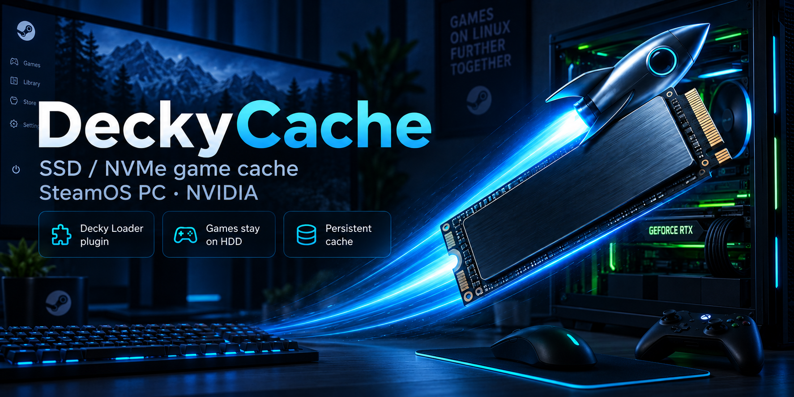
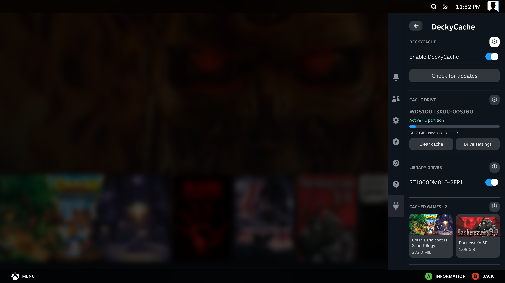

#  DeckyCache



## Check compatibility before installing

| Requirement | Current bundle |
| --- | --- |
| **Supported SteamOS channel** | **Stable only**. Beta, Preview and Main are not supported. |
| **Tested SteamOS** | **3.8.28**, build **20260922.1**, on an NVIDIA x86-64 PC |
| **Required kernel** | `6.18.50-valve2-1-neptune-618-gc7289a96b14d` |
| **Library drives** | Separate **ext4 data partitions** |
| **Tested Decky Loader** | **3.2.10** |

**Check `uname -r` in Desktop Mode before installing. The kernel must match exactly.**
The SteamOS version alone is not enough: an update may change the kernel.
This plugin does not rebuild or replace it; another kernel needs a matching module bundle.

[Full compatibility and update information](docs/guide/Compatibility.md)

**Keep your games on the HDD. Cache the data you use on an SSD or NVMe.**

DeckyCache is a Decky Loader plugin for SteamOS PC. Choose a dedicated cache drive,
switch on the library drives you want to cache, and play. Open CAS stores accessed
blocks on the faster drive while the original games and Steam updates stay on the HDD.

[Install](docs/guide/Installation.md) · [First setup](docs/guide/Setup.md) · [User guide](docs/guide/Home.md) · [Compatibility](docs/guide/Compatibility.md)

## What you get

- **Choose an SSD or NVMe:** format a dedicated drive or reuse one prepared by DeckyCache.
- **Choose library drives:** enable one or several supported game-drive partitions.
- **Master switch:** temporarily bypass cache while keeping your drive selections and valid cached blocks.
- **Compatible updates:** check GitHub for a release matching the running kernel, then install through Decky with an automatic plugin reload. The built-in updater keeps compatible cache and library mounts connected.
- **Persistent cache:** cached blocks survive a clean shutdown and restart.
- **Original games stay on the HDD:** writethrough sends writes, including game updates, to the original drive.
- **Cached games:** Steam games and direct non-Steam shortcuts, with existing Steam artwork and attributed cache sizes. Tiny entries appear under **Small fragments**.
- **Clear cache:** remove cached copies without formatting the NVMe or deleting games.
- **A compact controller-friendly panel:** short labels, section dividers and details behind information buttons.



## Download and install

**Download the DeckyCache plugin ZIP from this repository's Releases.**
Choose the attached plugin ZIP, not the automatically generated source-code archive.

1. Open **Decky Loader settings → General** and enable **Developer mode**.
2. Open **Developer → Install Plugin from ZIP File → Browse** and choose the downloaded ZIP.
3. Alternatively, copy the plugin ZIP's direct download link from the release and paste it into
   **Install Plugin from URL**, then select **Install**.
4. Open **DeckyCache** from the Decky menu.

See the [illustrated installation guide](docs/guide/Installation.md) for screenshots.
A download that requires signing in should be installed from the local ZIP.

For later updates, use **Check for updates** in DeckyCache, select the offered version and
confirm Decky's installer. The plugin reloads automatically. See [Updating the plugin](docs/guide/Installation.md#updating-the-plugin).

## First setup

1. Close games and let Steam downloads or updates finish.
2. In **Cache drive**, select your dedicated SSD/NVMe.
3. Choose **Format and use** for a new cache drive, or **Reuse existing cache** for a drive already prepared by DeckyCache.
4. Enable the desired partitions under **Library drives**.
5. Start a game. Cache fills as data is accessed.

**Format and use erases the entire selected cache drive.** Check its model, size and
serial number before confirming. The library HDD is not formatted or moved.
See [First setup](docs/guide/Setup.md).

## What gets cached

Caching covers **all folders on each selected partition**, including Steam libraries,
DRM-free games, ROMs and other files. This release has no per-folder filter, pinning,
full-game preloading or per-game eviction. The game list is partial attribution,
not proof that every byte of a game is cached.

[Compatibility and updates](docs/guide/Compatibility.md) · [How it works](docs/guide/How-It-Works.md) · [Troubleshooting](docs/guide/Troubleshooting.md)

## Build from source

```sh
cd plugin
npm ci
npm run typecheck
npm run build
cd ..
python3 scripts/package.py
```

Before packaging, prepare the matching Open CAS binaries as described in
[the bundle build guide](scripts/README-opencas-build.md). Packaging produces
`build/DeckyCache-<version>.zip` with the runtime, required licenses and offline user guide.

## License

The plugin uses the [BSD 3-Clause license](LICENSE). The release includes Open CAS,
OCF and safeclib license notices and an upstream source reference in `bin/opencas`.
