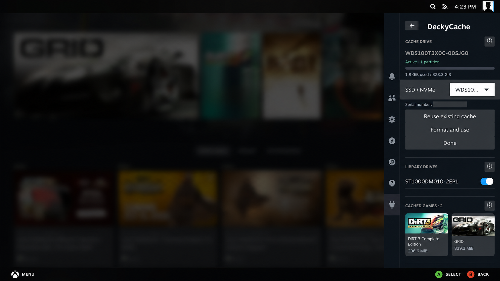

# First setup

Close games and let Steam downloads and updates finish before changing drive selection.

## Choose the cache SSD or NVMe

Open **DeckyCache**. If a cache drive is already selected, choose **Drive settings**.

1. Select the dedicated drive in **SSD / NVMe**.
2. Check the **model, capacity and serial number**.
3. Choose one of the options below.

| Control | Use it when | What it does |
| --- | --- | --- |
| **Format and use** | You want to prepare a dedicated cache drive. | Erases the selected drive and creates the cache filesystem. |
| **Reuse existing cache** | The drive was already prepared by DeckyCache. | Reuses the prepared filesystem without formatting it. Cached blocks are reused only when their saved state is valid. |
| **Done** | You have finished reviewing drive settings. | Returns to the compact main panel. |

**Format and use erases all data on the selected cache drive, including its existing partitions.**
The plugin excludes detected system drives and selected library drives. Confirm the drive identity
yourself before accepting **Format this drive**.

The serial number is hidden only in this documentation image. It remains visible in the plugin
so you can identify the correct disk.

## Select library drives

Under **Library drives**, enable each partition you want to cache.
Multiple partitions can share the selected SSD/NVMe.

The current selector works with mounted ext4 data partitions on separate, non-system drives.
Each switch applies to the **whole partition**. If Steam, DRM-free games and ROMs are in different
folders on that partition, all are eligible for cache. Other files on that partition are eligible too.

The original HDD filesystem and library path stay in place. There is no need to move or reinstall games.
Wait for **Active** before starting a game.

Changing the selected partitions redistributes cache space and rebuilds cached contents.
The games on the HDD remain intact.

## Play

Cache fills as data is accessed. The first read may come from the HDD; later reads can use NVMe.
The plugin does not copy entire games in advance.

The usage bar shows actual occupied cache blocks, not the preallocated backing-file size.
See [Everyday use](Daily-Use.md).
